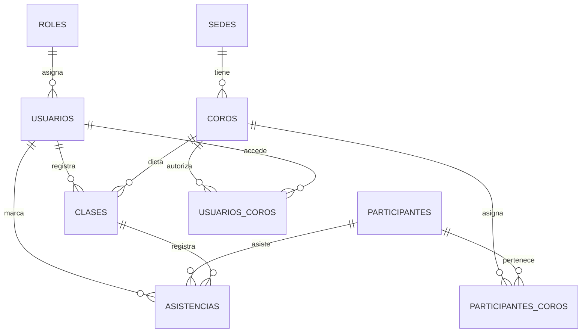

# Modelo de Datos — Cantar Presente

| Campo | Valor |
|---|---|
| Proyecto | Cantar Presente: sistema de gestión de participantes y asistencia para Sembrar Cantando |
| Autor | Tadeo Jablonski (DBA / Analista de Datos) |
| Fecha | 09/10/2026 |
| Versión | 0.2 — Borrador para revisión del equipo. v0.2: se agregan `dia_semana`/`horario` a `coros` (lo menciona PUT /api/choirs/:id) y `roles` usa `GENERATED BY DEFAULT` para permitir seeds con ids explícitos |
| Estado | Pendiente de validación con la ONG y el equipo de desarrollo |

## 1. Contexto y restricciones de origen

Documentos de referencia: Requerimientos (RF-01..29, RNF-01..22), Project Charter v1.2, Enfoque de Implementación v2.0, Relevamiento Inicial v3, KickOff V2, Registro de Riesgos.

Restricciones que condicionan el diseño:

- **Arquitectura offline-first**: PWA móvil (IndexedDB + Service Workers + Background Sync) con APIs REST serverless en Vercel y base **PostgreSQL** central en la nube. Solo planes gratuitos.
- **RF-07**: baja lógica de participantes conservando historial.
- **RF-08**: un participante en varios coros sin duplicar su registro personal (N:M).
- **RF-15/17**: asistencia por coro + fecha, con estados **presente / ausente / justificado**.
- **RF-22..26 / RNF-06 / RNF-18**: registro sin conexión y sincronización sin pérdidas ni duplicados desde múltiples dispositivos.
- **RF-01..03**: autenticación, usuarios y permisos por rol.
- **RF-27..29**: indicadores por coro/sede y alertas de ausentismo (umbral configurable).
- **Alcance (KickOff)**: NO incluye módulo de eventos, pagos ni donaciones.

## 2. Decisiones de diseño

1. **UUID como PK en todas las tablas, generado en el dispositivo**: única forma segura de sincronizar registros creados offline desde varios celulares sin colisiones de IDs (riesgo RSK.05).
2. **`updated_at` + `deleted_at` (tombstones) en todas las tablas**: el sync es push/pull con resolución *last-write-wins* por `updated_at`; las bajas lógicas viajan como tombstones.
3. **Idempotencia por restricciones UNIQUE + upsert (`ON CONFLICT`)**: `clases UNIQUE(coro_id, fecha)` y `asistencias PK(clase_id, participante_id)` garantizan que re-sincronizar nunca duplique (RF-25, RNF-06).
4. **Sedes separadas de coros** (RF-10/12): la sede del participante se deriva del coro; no se duplica.
5. **Membresía N:M participante↔coro con fechas de alta/baja** (RF-08, RF-13).
6. **Entidad `clases` (ensayos) explícita** entre coro y asistencia: soporta "justificado", quién registró, observaciones, y es la unidad deduplicable en el sync.
7. **RBAC ligero**: tabla de roles + `usuarios_coros` para limitar qué coros ve cada director/voluntario (RF-03, RF-13).

Roles absorbidos del relevamiento: "Madres" y "Directores" → `usuarios` con rol `voluntario` / `director_coro`, acotados por `usuarios_coros`. "Jefes de cuerda" → participantes con `rol` en la membresía. Tutor/responsable → campos en `participantes` (normalizar a tabla propia solo si un responsable tiene varios chicos y se quiere deduplicar contacto).

## 3. Diagrama entidad-relación



## 4. Tablas (DDL de referencia)

```sql
-- ============================== MAESTRAS ==============================

-- RF-10: administración de sedes
CREATE TABLE sedes (
    id          UUID PRIMARY KEY DEFAULT gen_random_uuid(),
    nombre      TEXT NOT NULL,
    direccion   TEXT,
    localidad   TEXT,
    activa      BOOLEAN NOT NULL DEFAULT TRUE,
    created_at  TIMESTAMPTZ NOT NULL DEFAULT now(),
    updated_at  TIMESTAMPTZ NOT NULL DEFAULT now(),
    deleted_at  TIMESTAMPTZ          -- tombstone para sync
);

-- RF-11/12: coros y su sede
CREATE TABLE coros (
    id          UUID PRIMARY KEY DEFAULT gen_random_uuid(),
    nombre      TEXT NOT NULL,
    sede_id     UUID NOT NULL REFERENCES sedes(id),
    activo      BOOLEAN NOT NULL DEFAULT TRUE,
    dia_semana  TEXT CHECK (dia_semana IN ('lunes','martes','miercoles','jueves','viernes','sabado','domingo')),
    horario     TIME,
    created_at  TIMESTAMPTZ NOT NULL DEFAULT now(),
    updated_at  TIMESTAMPTZ NOT NULL DEFAULT now(),
    deleted_at  TIMESTAMPTZ
);

-- RF-02/03: roles de acceso
CREATE TABLE roles (
    id          SMALLINT GENERATED BY DEFAULT AS IDENTITY PRIMARY KEY,
    nombre      TEXT NOT NULL UNIQUE,   -- 'admin' | 'coordinacion' | 'director_coro' | 'voluntario'
    descripcion TEXT
);

-- RF-01/02: usuarios autenticados
CREATE TABLE usuarios (
    id                      UUID PRIMARY KEY DEFAULT gen_random_uuid(),
    nombre                  TEXT NOT NULL,
    apellido                TEXT NOT NULL,
    email                   TEXT NOT NULL UNIQUE,
    password_hash           TEXT NOT NULL,
    rol_id                  SMALLINT NOT NULL REFERENCES roles(id),
    activo                  BOOLEAN NOT NULL DEFAULT TRUE,
    ultima_sincronizacion   TIMESTAMPTZ,
    created_at              TIMESTAMPTZ NOT NULL DEFAULT now(),
    updated_at              TIMESTAMPTZ NOT NULL DEFAULT now(),
    deleted_at              TIMESTAMPTZ
);

-- RF-03/13: qué coros puede operar cada usuario
CREATE TABLE usuarios_coros (
    usuario_id  UUID NOT NULL REFERENCES usuarios(id),
    coro_id     UUID NOT NULL REFERENCES coros(id),
    PRIMARY KEY (usuario_id, coro_id)
);

-- RF-04..07: padrón de participantes (baja lógica conservando historial)
CREATE TABLE participantes (
    id                    UUID PRIMARY KEY DEFAULT gen_random_uuid(),
    nombre                TEXT NOT NULL,
    apellido              TEXT NOT NULL,
    fecha_nacimiento      DATE,
    responsable_nombre    TEXT,
    responsable_telefono  TEXT,
    observaciones         TEXT,
    activo                BOOLEAN NOT NULL DEFAULT TRUE,
    created_at            TIMESTAMPTZ NOT NULL DEFAULT now(),
    updated_at            TIMESTAMPTZ NOT NULL DEFAULT now(),
    deleted_at            TIMESTAMPTZ
);

-- RF-08/13: membresía N:M participante↔coro, sin duplicar datos personales
CREATE TABLE participantes_coros (
    id               UUID PRIMARY KEY DEFAULT gen_random_uuid(),
    participante_id  UUID NOT NULL REFERENCES participantes(id),
    coro_id          UUID NOT NULL REFERENCES coros(id),
    fecha_alta       DATE NOT NULL DEFAULT CURRENT_DATE,
    fecha_baja       DATE,                  -- baja de la membresía (no del participante)
    rol              TEXT,                  -- 'integrante' | 'jefe_cuerda'
    created_at       TIMESTAMPTZ NOT NULL DEFAULT now(),
    updated_at       TIMESTAMPTZ NOT NULL DEFAULT now(),
    UNIQUE (participante_id, coro_id)
);

-- ============================ TRANSACCIONALES ==========================

-- RF-15/16: sesión de ensayo por coro y fecha (unidad deduplicable del sync)
CREATE TABLE clases (
    id            UUID PRIMARY KEY DEFAULT gen_random_uuid(),
    coro_id       UUID NOT NULL REFERENCES coros(id),
    fecha         DATE NOT NULL,
    hora          TIME,
    usuario_id    UUID REFERENCES usuarios(id),   -- quién registró la sesión
    observaciones TEXT,
    created_at    TIMESTAMPTZ NOT NULL DEFAULT now(),
    updated_at    TIMESTAMPTZ NOT NULL DEFAULT now(),
    deleted_at    TIMESTAMPTZ,
    UNIQUE (coro_id, fecha)                       -- idempotencia de sincronización
);

-- RF-17..21: estado de cada participante en cada clase
CREATE TABLE asistencias (
    clase_id        UUID NOT NULL REFERENCES clases(id),
    participante_id UUID NOT NULL REFERENCES participantes(id),
    estado          TEXT NOT NULL CHECK (estado IN ('presente','ausente','justificado')),
    registrado_por  UUID REFERENCES usuarios(id),
    created_at      TIMESTAMPTZ NOT NULL DEFAULT now(),
    updated_at      TIMESTAMPTZ NOT NULL DEFAULT now(),
    PRIMARY KEY (clase_id, participante_id)       -- upsert idempotente (ON CONFLICT)
);

-- ============================== SOPORTE ================================

-- Parámetros del negocio (ej. umbral de alerta de ausentismo)
CREATE TABLE configuracion (
    clave TEXT PRIMARY KEY,
    valor JSONB NOT NULL
);

-- Log de sincronizaciones (auditoría y resolución de conflictos)
CREATE TABLE sincronizaciones (
    id              UUID PRIMARY KEY DEFAULT gen_random_uuid(),
    dispositivo_id  TEXT NOT NULL,
    usuario_id      UUID REFERENCES usuarios(id),
    fecha           TIMESTAMPTZ NOT NULL DEFAULT now(),
    registros_ok    INTEGER NOT NULL DEFAULT 0,
    registros_err   INTEGER NOT NULL DEFAULT 0,
    estado          TEXT NOT NULL CHECK (estado IN ('ok','parcial','error')),
    detalle         JSONB
);
```

## 5. Índices

| Índice | Requerimiento que atiende |
|---|---|
| `coros(sede_id)` | RF-09/28: conteos y reportes por sede |
| `clases(coro_id, fecha)` (cubierto por UNIQUE) | RF-20: asistencia por coro y fecha |
| `asistencias(participante_id, clase_id)` | RF-19/21: historial del participante |
| Parcial `participantes_coros(coro_id) WHERE fecha_baja IS NULL` | RF-09/16: padrón activo por coro |

## 6. Sincronización offline (RF-22..26)

- **IndexedDB local** = espejo reducido de la BD central: sedes/coros/participantes (los coros del usuario), clases/asistencias pendientes y una **outbox** con las operaciones.
- Flujo: push de la outbox (upserts por PK/UNIQUE) → pull de cambios remotos desde `ultima_sincronizacion` → conflictos por `updated_at` (last-write-wins).
- Toma de asistencia: al crear la clase, el frontend materializa filas `ausente` para todos los miembros activos; el director solo marca presentes/justificados (cumple RF-17 sin asumir "ausente = sin fila").

## 7. Indicadores y reportes (RF-27..29)

Vistas/consultas sobre las tablas (sin materialización; el volumen no la justifica — RNF-14):

- `% asistencia` mensual por coro y por sede (pivot de estados).
- Historial de asistencia por participante (RF-19).
- Rachas de ausencias consecutivas (window functions) cruzadas contra `configuracion` → alertas de ausentismo.
- Totales de participantes activos por coro y sede (RF-09).
- Tendencias de participación para reportes a donantes.

## 8. Trazabilidad requerimientos → tablas

| RF | Tablas |
|---|---|
| RF-01..03 | `usuarios`, `roles`, `usuarios_coros` |
| RF-04..07 | `participantes` (`activo` = baja lógica) |
| RF-08, RF-13 | `participantes_coros` |
| RF-09, RF-14, RF-28 | `sedes`, `coros`, `participantes_coros` |
| RF-10..12 | `sedes`, `coros` |
| RF-15..18 | `clases`, `asistencias` |
| RF-19..21, RF-27, RF-29 | `clases`, `asistencias` (+ vistas de la sección 7) |
| RF-22..26 | PK UUID, `UNIQUE`, tombstones, `sincronizaciones` |

## 9. Puntos abiertos para validar

1. **¿Una clase por día por coro?** RF-15 sugiere que sí (así lo refleja `UNIQUE(coro_id, fecha)`). Si un coro ensaya dos veces el mismo día, agregar `hora` a la clave.
2. **Campos del legajo**: se propone el mínimo (nombre, apellido, fecha_nacimiento, responsable + teléfono) por tratarse de menores. ¿La ONG pidió DNI/dirección?
3. **¿Las "Madres" registran asistencia además de los directores?** Asumido que sí (`usuarios_coros` las cubre). Confirmar con la ONG.
4. **"Eventos" del relevamiento**: excluidos del alcance por el KickOff. Si se requieren presentaciones especiales, una tabla `eventos` reutilizaría el patrón de `clases`.
5. **Alertas**: ¿se evalúan on-demand en el panel admin o requieren envío proactivo? (afecta a la app, no al esquema).
